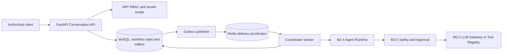

# M3.1 — Supervisor Architecture & Implementation Package

**Status:** Remediated architecture baseline. Documentation only; no implementation, migration, API, or volume operation is performed by this package.

## 1. Purpose and fixed decisions

M3.1 defines the foundation for a Supervisor that will eventually coordinate up to 13 specialist agents. The Supervisor is an orchestration component, not a clinical authority and not an alternate path around M2.5.

The following decisions are fixed:

- FastAPI modular monolith.
- MySQL is the authoritative workflow database.
- MySQL transactional outbox is the durable event source.
- Redis is a recoverable delivery accelerator/cache, never authoritative workflow state.
- Alembic history is forward-only; existing revisions are never edited.
- M3 adds additive `/api/v1/conversations` APIs and preserves M1/M2/M2.5 behavior.
- Organization, project, conversation, agent, and user isolation is mandatory.
- M2.5 safety and approval controls are non-bypassable from M3.1.3 onward.
- Existing MySQL and Redis volumes must be preserved; no reset, drop, recreation, or deletion is authorized.

## 2. Architecture



The only valid execution route is:

`Supervisor plan → M2.4 runtime execution → M2.5 safety/approval → LLM provider or registered tool`

The Supervisor can validate a plan, select eligible agents, and display approval state. It cannot approve, override, suppress, downgrade, or reclassify any M2.5 outcome. This rule applies to direct, delegated, parallel, retry, recovery, and provider-fallback work.

## 3. Delivery phases

| Phase | Scope | Exit condition |
| --- | --- | --- |
| M3.1.1 | Conversation & Message Database Foundation | Additive tenant-safe schema and persistence tests pass |
| M3.1.2 | Transactional Outbox & Event Dispatcher | Durable publish/replay and Redis recovery tests pass |
| M3.1.3 | Supervisor Core & Agent Routing | All high-impact paths use existing M2.5 approval enforcement |
| M3.1.4 | Integration, Security & Acceptance Tests | Migration, security, recovery, approval, and regression evidence is recorded |

M3.2 must not start before the section 13 acceptance gate is met.

## 4. Database entity and constraint specifications

All M3 entities contain `organization_id`, UTC timestamps, and tenant-first indexes. Organization-owned foreign keys use `(organization_id, id)` composite targets wherever the current schema permits; IDs alone must not create a cross-tenant relationship.

### 4.1 `conversations`

| Field | Constraint / purpose |
| --- | --- |
| `id`, `organization_id` | Primary ID; unique `(organization_id, id)` tenant target |
| `project_id` | Composite FK to project when non-null; organization-level conversation requires explicit policy |
| `created_by_user_id` | Existing user FK; service verifies organization membership |
| `status` | Check constraint from section 9 |
| `state_version` | Not null, default `1`, check `>= 1`; optimistic concurrency token |
| `created_at`, `updated_at`, `completed_at` | UTC timestamps |

Indexes: `(organization_id, project_id, updated_at)` and `(organization_id, status, updated_at)`.

### 4.2 `conversation_members`: exclusive identity

| Field | Constraint / purpose |
| --- | --- |
| `id`, `organization_id`, `conversation_id` | Identity and composite FK to conversation |
| `member_type` | Check: `user` or `agent` |
| `user_id` | Nullable FK; required only for `member_type='user'` |
| `agent_profile_id` | Nullable composite FK to `(organization_id, agent_profiles.id)`; required only for `member_type='agent'` |
| `membership_role` | Check: `owner`, `participant`, `observer`, `supervisor` |
| `created_at`, `removed_at` | UTC; removal is not a physical delete |

Required check:

```text
CHECK (
 (member_type='user' AND user_id IS NOT NULL AND agent_profile_id IS NULL) OR
 (member_type='agent' AND user_id IS NULL AND agent_profile_id IS NOT NULL)
)
```

Required uniqueness:

- `(organization_id, conversation_id, user_id)` for user membership;
- `(organization_id, conversation_id, agent_profile_id)` for agent membership.

MySQL nullable unique-index behavior must be tested. If it cannot express the desired uniqueness, use generated discriminator columns in a new migration, plus the exclusive check above. Application logic also verifies active organization/project membership, active project assignment, active agent status, and published version before assignment.

### 4.3 `conversation_messages`

| Field | Constraint / purpose |
| --- | --- |
| `id`, `organization_id`, `conversation_id` | Identity and composite conversation FK |
| `sequence_number` | Server allocated; unique `(organization_id, conversation_id, sequence_number)` |
| `sender_kind`, `sender_user_id`, `sender_agent_profile_id` | Exclusive identity check as members; `system` requires both identities null |
| `message_type` | Check: `user_message`, `agent_progress`, `agent_result`, `system_event`, `approval_notice`, `error_notice` |
| `content_ciphertext` | Original local message content only when retention policy permits; application-layer encrypted at rest when classified sensitive or potential patient-identifying |
| `content_redacted` | Derived redacted representation for ordinary timeline display, event payloads, and provider preparation; never a substitute for authorization to disclose data |
| `data_classification`, `encryption_key_ref`, `retention_expires_at` | Classification, key reference kept separate from ciphertext, and retention lifecycle control |
| `payload_metadata` | Sanitized metadata only—never raw protected identifiers, raw message content, or secrets |
| `idempotency_key` | Unique `(organization_id, conversation_id, idempotency_key)` |
| `correlation_id`, `causation_id`, `created_at` | Event lineage and UTC auditability |

Messages are append-only through normal APIs. Corrections/retractions are new messages referencing the original metadata; clients never set sequence number.

### 4.4 `supervisor_plans`

Versioned, declarative, schema-validated plans only: `organization_id`, `conversation_id`, `plan_version`, `request_message_id`, `schema_version`, `plan_json`, `status`, creator metadata, timestamps. Uniqueness: `(organization_id, conversation_id, plan_version)` and `(organization_id, request_message_id)`.

The validator enforces task count, task type, dependency acyclicity, delegation depth, agent eligibility, and capabilities. Plans cannot include executable code, provider keys, arbitrary endpoints, shell commands, arbitrary tools, or approval decisions.

### 4.5 `conversation_tasks` and dependency DAG

`conversation_tasks` holds `id`, `organization_id`, `conversation_id`, `plan_id`, `task_key`, `agent_profile_id`, `agent_version_id`, nullable `execution_id`, `task_type`, `status`, `is_high_impact`, `state_version`, `idempotency_key`, timestamps, and sanitized error metadata.

Required uniqueness: `(organization_id, id)`, `(organization_id, conversation_id, id)`, `(organization_id, conversation_id, task_key)`, and `(organization_id, plan_id, idempotency_key)`. The `(organization_id, conversation_id, id)` key is the referenced tenant-and-conversation boundary for dependency rows.

There is **no** single `depends_on_task_id` field. A multi-dependency relation supports a DAG:

### 4.6 `conversation_task_dependencies`

| Field | Constraint / purpose |
| --- | --- |
| `id` | Primary key for dependency auditability and stable references |
| `organization_id` | Required tenant scope |
| `conversation_id` | Required; composite FK to `(organization_id, id)` in `conversations` |
| `task_id` | Composite FK `(organization_id, conversation_id, task_id)` to `(organization_id, conversation_id, id)` in `conversation_tasks` |
| `depends_on_task_id` | Same composite FK to prerequisite task in the same tenant and conversation |
| `created_at` | UTC timestamp |

Required constraints/indexes:

- primary key on `id` and unique `(organization_id, task_id, depends_on_task_id)`;
- check `task_id <> depends_on_task_id`;
- composite foreign keys that include `organization_id` and `conversation_id` for both task references;
- indexes `(organization_id, conversation_id, task_id)` and `(organization_id, conversation_id, depends_on_task_id)`;
- service validation in the same transaction that both tasks share the same plan and the proposed edge has no cycle.

The composite FKs guarantee that both task references belong to the same tenant and conversation. Same-plan and acyclic requirements still require service validation because ordinary FKs cannot prove them.

### 4.7 `conversation_audit_logs`

Store tenant/conversation ID, action, actor kind/ID, correlation ID, sanitized metadata, and timestamp. Link to existing M2.4 execution audit and M2.5 approval IDs; do not duplicate their token, retry, or approval authority.

## 5. Transactional Outbox delivery and recovery contract

### 5.1 `workflow_outbox_events` schema

| Field | Constraint / purpose |
| --- | --- |
| `id`, `organization_id` | Event identity; unique `(organization_id, id)` |
| `aggregate_type`, `aggregate_id` | e.g. conversation and conversation UUID |
| `event_type`, `event_version` | Stable event contract |
| `payload` | Schema validated and sanitized; no secrets or raw PII except approved encrypted protected path |
| `status` | Check: `pending`, `processing`, `published`, `failed` |
| `idempotency_key` | Unique `(organization_id, idempotency_key)` |
| `attempt_count`, `max_attempts` | Checks: `attempt_count >= 0`, `max_attempts >= 1` |
| `next_attempt_at` | Scheduler eligibility |
| `lease_owner`, `lease_expires_at` | Publisher lease and crash recovery |
| `last_error_code`, `last_error_message` | Sanitized diagnosis/retry error only; never a secret or protected identifier |
| `published_at`, `created_at`, `updated_at` | UTC lifecycle timestamps |

Indexes: `(status, next_attempt_at, lease_expires_at)` after query-plan review, plus `(organization_id, aggregate_type, aggregate_id, created_at)` and the idempotency unique index.

### 5.2 At-least-once delivery

1. In one MySQL transaction, persist the domain change, audit row, and `pending` outbox event.
2. Commit MySQL before attempting Redis delivery.
3. A publisher lease-claims eligible `pending` or expired `processing` events through row-lock/lease-safe SQL, setting `status='processing'`, owner, and expiry.
4. Publish to the Redis Stream with `XADD` (or an equivalent dispatcher). Delivery is **at least once**; it is never represented as exactly-once.
5. On acknowledged publication, mark `published`, set `published_at`, and clear lease fields.
6. On transient error, increment attempts, record sanitized error, set `next_attempt_at` using bounded exponential backoff with jitter, and return the event to `pending` while releasing/expiring the lease.
7. At `max_attempts`, mark `failed`, retain record/audit history, alert operations, and require an explicit replay decision that creates a new controlled attempt.

Consumers deduplicate by event ID/idempotency key before creating messages, tasks, executions, approvals, or external calls. They acknowledge only after their own MySQL transaction commits. Duplicate delivery must be harmless.

For Redis Streams, consumers run in a consumer group. A consumer writes its idempotency/state result to MySQL first, commits, and only then issues `XACK`; an unacknowledged stream entry is therefore safe to redeliver. A recovery consumer uses `XAUTOCLAIM` for idle pending entries (or `XPENDING` followed by `XCLAIM` where required by the Redis version) after a configured idle threshold. Reclaimed entries still pass the same event-ID/idempotency deduplication before side effects.

### 5.3 Recovery

- A publisher lease past `lease_expires_at` is reclaimable after publisher crash; the next publisher returns it to the retry path safely.
- Redis outage/restart delays delivery only; MySQL retains events for replay.
- `published` records transport delivery, not consumer success; consumer idempotency/state establishes processing success.
- Redis flush/reset is never a recovery mechanism.
- A failed-event replay is an audited operator action after idempotency review; it must not overwrite original evidence.

## 6. API compatibility contract

M3 adds these APIs only:

| Method | Endpoint | Permission | Purpose |
| --- | --- | --- | --- |
| POST | `/api/v1/conversations` | `conversation.write` | Create scoped conversation idempotently |
| GET | `/api/v1/conversations` | `conversation.read` | List caller-visible conversations |
| GET | `/api/v1/conversations/{id}` | `conversation.read` | Read metadata/state/version |
| POST | `/api/v1/conversations/{id}/messages` | `conversation.write` | Append user message idempotently |
| GET | `/api/v1/conversations/{id}/messages` | `conversation.read` | Read ordered visible history |
| GET | `/api/v1/conversations/{id}/plans` | `conversation.read` | Read validated plans, never hidden reasoning |

Do not rename/remove/change existing `/api/v1` behavior. Clients cannot set execution state, provider routing, membership, approval state, outbox state, or message sequence. Response fields are additive; persisted JSON has `schema_version`; breaking change requires a separate versioned API plan.

## 7. Mandatory M2.5 approval enforcement in M3.1.3 (not deferred to M3.5)

M3.5 may add end-to-end hardening, observability, and coverage; it cannot defer or introduce first approval enforcement. M3.1.3 must invoke M2.5 before creating any runnable M2.4 execution.

| Path | M3.1.3 requirement |
| --- | --- |
| Supervisor direct task | Evaluate M2.5; high-impact task waits on existing approval record |
| Delegated task | Independently evaluate; inherited approval is invalid |
| Parallel task | Each task has independent policy/approval state |
| Retry/recovery | Recheck approval validity and final payload safety |
| Provider fallback | Recheck final prompt/provider classification at M2.5 egress |
| Tool request | Apply registered-tool limits/permissions and M2.5 classification |

Only a persisted M2.5/M2.4 `approved` decision by a separate authorized human may release a matching task from `waiting_approval`. Rejection/expiry cancels or blocks it and creates an audited status event. No Supervisor API, service method, or database write path may set approval approved.

This boundary is invariant across retries, delegated work, parallel branches, recovery, provider fallback, and tool execution. The Supervisor has neither `agent.approve` authority nor an API/permission that can act on behalf of an approver.

## 8. Conversation PII, privacy, and security controls

### Classification and minimization

At intake classify content as `public`, `internal`, `sensitive`, or `potential_patient_identifying`; uncertainty is sensitive. Store only minimum necessary workflow content. Patient-identifying data is never generic shared context, generic outbox payload, or shared agent memory.

### User-message PII handling lifecycle

1. When a user submits `conversation_messages.content`, perform deterministic PII detection/classification before creating message-derived metadata, an outbox payload, an audit entry, or an LLM request. Detection is conservative and is not a clinical/legal determination of identity.
2. A potential identifier does **not** automatically discard the user’s local message. The authorized local platform may retain the original only when the approved retention policy permits it, as `content_ciphertext` encrypted at rest with a deployment-managed key. It must never retain the same raw value in `content_redacted`, plan JSON, generic context, outbox payload, or audit metadata.
3. Persist a redacted derivative for normal timeline display and for any workflow metadata that does not require the protected original. Redaction replaces detected values with stable placeholders only where correlation is required; otherwise it removes them.
4. Enforce organization, project, conversation-membership, and role checks before reading either form. Decrypting/returning protected content requires an explicitly authorized role and purpose; ordinary participation alone does not imply protected-content access.
5. Create a `conversation.content_viewed` audit event whenever protected content is decrypted or returned to an authorized user. The event records viewer user ID, organization/conversation/message identifiers or bounded message range, purpose/role, timestamp, correlation ID, and outcome—never the raw content itself.
6. Use only the redacted/minimized content for event metadata and outbox payloads. Before any provider call, M2.5 re-evaluates the complete final prompt rather than trusting intake classification.

### External LLM egress

- M2.5 receives the complete final prompt before every external call: history excerpt, plan context, tool result, retry/fallback content, and synthesis.
- Potential patient-identifying content is denied for external providers unless a future separately authorized policy establishes legal processing, explicit authorization, de-identification/minimization, and gateway controls. No such exception is enabled in M3.1.
- Redaction/de-identification is defense in depth, not permission to transmit protected data. Never log the original protected value. An external-provider request uses redacted content only after M2.5 authorizes the final payload; raw `content_ciphertext` is never sent.
- Local workflows remain minimum-necessary, scoped, and high-impact approval controlled.

### Encryption, access, audit, and retention

- Encrypt protected conversation content at rest with deployment-managed keys; use TLS in transit. Keep the original in `content_ciphertext` and the key reference in `encryption_key_ref`, never together with provider/audit metadata.
- Keep key references separate from encrypted values; never put keys in content, plans, outbox, or audit data.
- Enforce organization, project, membership, and RBAC checks for every content access; audit permission does not bypass decryption scope.
- Audit metadata records IDs, classification, policy decision, actor, correlation ID, provider/model destination, aggregate token/cost, and sanitized error—not raw prompt, secret, identifier, or raw message content. Content-view audit events identify the authorized user who accessed protected content.
- Retention periods for redacted content, encrypted sensitive content, access/audit metadata, outbox, and failed events must be approved before M3.1.1. Expiry/disposal is scoped, auditable, and must never delete MySQL/Redis volumes. Disposal must remove ciphertext/key access according to approved policy while retaining only the minimum legally/operationally required sanitized audit record.

## 9. Conversation state, concurrency, and idempotency

### 9.1 Server-owned transition matrix

| Current | Allowed next | Server-owned condition |
| --- | --- | --- |
| `draft` | `active`, `cancelled` | Creation/member setup succeeds; authorized cancel |
| `active` | `processing`, `waiting_approval`, `cancelled` | Valid turn/plan; M2.5 requires approval; authorized cancel |
| `processing` | `active`, `waiting_approval`, `completed`, `failed`, `cancelled` | Coordinator observes task result; no client-set transition |
| `waiting_approval` | `processing`, `active`, `cancelled`, `failed` | Existing stored approval decides or workflow fails |
| `completed` | `active` | Authorized new user turn creates new correlation/plan version |
| `failed` | `active`, `cancelled` | Authorized retry/new turn or cancellation |
| `cancelled` | `active` | Authorized explicit new turn |

Clients issue commands, not target states. Prior history is never mutated when a conversation reopens.

### 9.2 Transactional state update and optimistic concurrency

- A command handler validates authorization, current state, M2.5 approval state where applicable, and idempotency before mutation. In one MySQL transaction it appends the message/audit record, updates conversation/task state, increments `state_version`, and inserts the matching outbox event.
- State transition SQL includes the caller/worker's expected `state_version` in its `WHERE` clause and atomically increments it. A zero-row update means conflict, never success.
- On version mismatch, the API returns `409 Conflict` with a stable conflict code and the latest safe state/version metadata. It must not silently retry a client command or report success. A worker may retry only after reloading state and confirming that its idempotency and transition preconditions still hold.
- Task transitions use `conversation_tasks.state_version`; stale event consumers cannot overwrite a newer state.
- Every create-message request carries an idempotency key unique within tenant/conversation.
- Same key plus same canonical request returns original result; same key with differing request returns conflict.
- Server assigns sequence/correlation values once in the atomic message/outbox transaction.
- Consumers deduplicate before side effects and acknowledge only after MySQL commit.

### 9.3 State ownership rules

- API clients may submit commands such as create conversation, submit message, or cancel a conversation. They never submit a target state for `processing`, `waiting_approval`, `completed`, `failed`, or `cancelled`.
- The server-side Supervisor/coordinator is the only actor that moves a valid active turn into `processing`, reacts to runtime events, and determines terminal workflow state from persisted task outcomes.
- Only the existing M2.4/M2.5 approval decision path can move work out of `waiting_approval`; the Supervisor and client cannot manufacture that transition.
- Recovery workers use the same server transition matrix, correlation ID, idempotency key, and expected version checks as live workers.

## 10. Migration and volume protection

1. Confirm current Alembic head; create a new revision using it as `down_revision`.
2. Add M3 tables, constraints, FKs, and indexes only. Do not edit historic migrations or destructively alter M1/M2/M2.5 data.
3. Deploy behind disabled-by-default feature flag; migrate with `alembic upgrade head` after backup procedure approval.
4. Record before/after revision and migration output. New M3 tables require no backfill.
5. To stop rollout, disable M3 traffic; do not use destructive downgrade/reset as normal rollback.

Prohibited: `docker compose down -v`, `docker volume rm`, `docker system prune --volumes`, database drop/recreate, destructive seed, migration-history reset, and Redis `FLUSHALL`/`FLUSHDB` in shared/acceptance environments. Use `docker compose up -d --build api` without volume flags. Take/verify MySQL backup before actual migration.

## 11. Architecture change log

| Mandatory finding | Remediation |
| --- | --- |
| One dependency column cannot model a DAG | Added tenant-scoped `conversation_task_dependencies` with two composite FKs, uniqueness, self-edge check, same-plan/conversation and cycle validation |
| Outbox insufficient for production recovery | Added pending/processing/published/failed status, attempts, retry time, lease owner/expiry, sanitized error fields, Redis Streams acknowledgement/reclaim, and at-least-once idempotent recovery contract |
| Membership can mean both/neither identity | Added exclusive `member_type` identity check and separate user/agent uniqueness requirements |
| M2.5 deferred to M3.5 | Made enforcement mandatory in M3.1.3 on all execution paths; M3.5 only expands coverage |
| Conversation PII rules incomplete | Added classification, external egress denial/redaction, encryption, access, audit minimization, and retention controls |
| State/idempotency incomplete | Added transition matrix, server ownership, optimistic concurrency, client and consumer idempotency rules |

## 12. Test matrix

This document does not claim any test has passed. Each requires recorded execution evidence in its implementation phase.

| Area | Required evidence |
| --- | --- |
| Migration | Upgrade populated M2 schema; confirm existing migration history/data remains intact |
| Isolation | Cross-org/project/non-member access to conversation/message/plan/task/outbox is denied |
| Membership | DB rejects both identities, neither identity, and duplicate active membership |
| Dependency DAG | Multiple prerequisites work; duplicate/self/cross-conversation/cyclic edges reject |
| Concurrency/messages | Duplicate submit returns same result; conflicting idempotency reuse rejects; stale `state_version` returns `409 Conflict`; concurrent updates lose no event |
| Outbox | Atomic domain/audit/outbox transaction; Redis outage, lease reclaim, retry, failed-event handling, `XACK`-after-commit, pending-entry reclaim, and duplicate consumer tests |
| M2.5 | Direct/delegated/parallel/retry/fallback/tool high-impact path cannot run absent valid approval; bypass/self-approval denied |
| Privacy | Protected identifier minimized in audit/outbox and denied at final external egress |
| Regression | Existing M1/M2/M2.5 API contracts remain green |
| Volume safety | Deployment evidence contains no volume delete/reset/recreate operation |

## 13. M3.1 acceptance gate

M3.2 must not begin until actual passing evidence exists for:

- Forward-only migration and untouched history.
- M1/M2/M2.5 API compatibility/regression suite.
- Organization, project, conversation, agent, membership, and dependency isolation.
- Outbox at-least-once delivery, lease recovery, duplicate handling, and Redis outage recovery.
- M2.5 approval enforcement over every M3.1.3 high-impact route.
- PII classification, egress protection, access control, audit minimization, and retention controls.
- Preservation of MySQL and Redis volumes.

## 14. Explicit prerequisites for M3.1.1

1. Confirm Alembic head and review current MySQL composite-key/constraint patterns.
2. Approve retention schedule, classification definitions, encryption/key-management mechanism, and decryption authority.
3. Decide organization-level versus project-required conversations and participant membership policy.
4. Approve mapping for `conversation.read`, `conversation.write`, `conversation.manage`, and `conversation.audit.read`.
5. Assign MySQL backup/restore owner, location, and verified pre-migration procedure.
6. Select Redis delivery/consumer mechanism and owner for health/backlog metrics.
7. Define feature-flag configuration and disabled-by-default deployment order.
8. Approve task limit, task taxonomy, delegation depth, outbox retry/backoff/max-attempt values, and failed-event replay operator ownership.
9. Document authorization process for future external LLM use; PII egress remains denied until then.
10. Provide populated non-production M2 data and persistent MySQL/Redis volumes for migration/recovery testing.

## 15. M3.1.1 implementation alignment and evidence

The following architecture elements are implemented by the forward-only `20261112_0009` migration and additive API code:

- `conversations`, exclusive-identity `conversation_members`, encrypted/redacted `conversation_messages`, `conversation_audit_logs`, `conversation_tasks`, and tenant/conversation-scoped `conversation_task_dependencies`.
- Composite tenant/conversation foreign keys and the multi-dependency uniqueness/self-edge constraints described in section 4.
- Additive conversation create/read/message APIs, organization and conversation-membership scoped reads, message idempotency, sequence allocation, state-version conflict handling, and append-only audit entries.
- Incoming user-message classification/redaction before persistence of derived content; original message content is encrypted in `content_ciphertext`, while API responses expose the redacted form only.

Recorded local verification on 2026-11-12:

- `alembic heads` reported `20261112_0008` before migration.
- `alembic upgrade head` completed `20261112_0008 -> 20261112_0009` on the existing local MySQL volume; `alembic current` reported `20261112_0009 (head)`.
- Full API test suite completed with `41 passed, 1 warning`.
- `alembic check` completed with `No new upgrade operations detected`, after SQLAlchemy metadata was aligned with the applied schema.

Boundaries intentionally not implemented in M3.1.1 remain deferred: transactional outbox/Redis dispatcher (M3.1.2), Supervisor planning/routing and M2.5 workflow bridge (M3.1.3), and end-to-end recovery/acceptance hardening (M3.1.4). The database task foundation does not create runnable agent work, so it does not create an M2.5 bypass path.

For production, `CONVERSATION_ENCRYPTION_KEY` must be configured as a dedicated deployment-managed secret. The development fallback derived from `APP_SECRET_KEY` exists only to keep local/test environments operable and is not an approved production key-management configuration.
