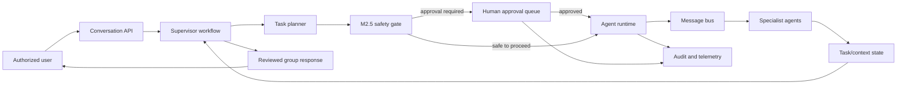
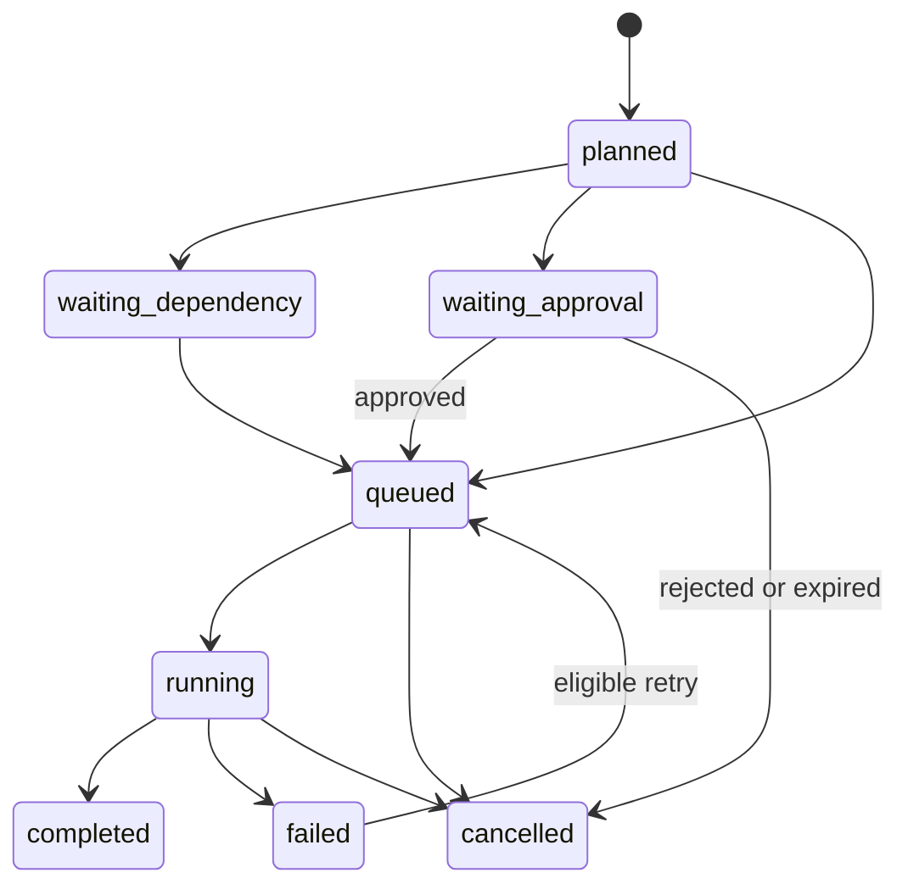

# M3 — Supervisor Agent & Multi-Agent Group Chat

**Status:** M3.2 authorized to start for local development after M3.1.4 local-integration acceptance. Production readiness is not certified.

## Objective

Deliver a Messenger-style, organization-scoped group-chat workflow in which a Supervisor Agent receives a user request, creates an auditable task plan, coordinates specialized agents, and presents a consolidated result. M3 is a decision-support workflow: it must not autonomously diagnose, prescribe, refer, publish, delete, make payments, change access, or otherwise perform high-impact actions.

M3 builds on M1/M2 identity, tenant isolation, agent registry, runtime execution, and M2.5 LLM/tool safety controls. It must not bypass any of them.

## Scope and non-goals

### In scope

- Supervisor-led task decomposition, delegation, and result synthesis.
- Persistent conversations, messages, task runs, collaboration state, and audit events.
- Sequential, parallel, and delegated collaboration patterns.
- Human approval workflow integration for high-impact work and final operational use.
- Failure recovery, cancellation, retry, and transparent status reporting.

### Out of scope

- Autonomous clinical decision-making or intervention.
- Unapproved transmission of patient-identifying data to an external LLM.
- Arbitrary code execution, shell access, or unregistered tools.
- Cross-organization conversations, context, agents, or memory.
- Healthcare RAG/organizational knowledge retrieval (M4).

## Architecture overview



### Design invariants

1. Every record is organization-scoped, and every API read/write validates organization membership and RBAC.
2. The Supervisor proposes and coordinates; it is not an alternate path around M2.5, and it never approves, overrides, or downgrades a safety decision.
3. Every agent-originated request for a high-impact action—whether direct, delegated, retried, parallel, or generated by the Supervisor—must pass through the same M2.5 approval gate and stored approval decision.
4. M2.5 is invoked at the final LLM egress boundary for every prompt, retry, fallback, tool result, attachment summary, and synthesized context.
5. A pending approval makes the relevant task/execution non-runnable. No Supervisor transition, queue worker, retry path, delegation, or agent message may bypass it.
6. Group-chat history is append-only in normal use. Corrections/retractions are new events, not destructive edits.
7. Only assigned, active agents with a published version may receive tasks.
8. Messages and audit logs must not store provider secrets; sensitive values remain redacted.

---

## M3.1 — Supervisor Core

### Responsibilities

The Supervisor receives a user message and produces a structured plan rather than directly issuing unrestricted work:

1. Validate conversation, project, organization, user permission, and participating agents.
2. Classify intent and detect explicit high-impact intent.
3. Decompose the request into bounded tasks with acceptance criteria, dependencies, requested capabilities, and expected output type.
4. Select eligible specialist agents by project assignment, status, capability, and model route requirements.
5. Choose a collaboration strategy: `sequential`, `parallel`, or `delegated`.
6. Create task and execution records; publish work messages only after policy checks.
7. Track statuses and combine agent outputs into a draft response that states uncertainty and provenance.
8. Request human review where policy requires it; present only approved operational output as final.

### Supervisor plan contract

```json
{
  "goal": "Prepare a de-identified monthly MNCH indicator summary",
  "strategy": "parallel",
  "tasks": [
    {
      "key": "validate-input",
      "agent_id": "uuid",
      "task_type": "data_validation",
      "depends_on": [],
      "required_capabilities": ["analysis"],
      "approval_required": false,
      "acceptance_criteria": ["Report missing values and denominator issues"]
    },
    {
      "key": "draft-summary",
      "agent_id": "uuid",
      "task_type": "reporting",
      "depends_on": ["validate-input"],
      "required_capabilities": ["chat"],
      "approval_required": false,
      "acceptance_criteria": ["Use only validated aggregate data"]
    }
  ]
}
```

The plan is data, not executable code. Server-side validation enforces maximum task count, maximum nesting depth, allowed task types, valid dependencies, organization scope, and agent assignment.

### Suggested service boundaries

| Component | Responsibility |
| --- | --- |
| `SupervisorService` | validates request, creates plan, advances workflow state |
| `TaskPlanner` | creates schema-validated plan from user intent |
| `AgentSelector` | selects only eligible project-assigned agents |
| `WorkflowCoordinator` | resolves dependencies, schedules work, cancellation, recovery |
| `ResponseSynthesizer` | produces labeled, traceable draft response |
| `ApprovalBridge` | delegates to M2.5/runtime approval APIs; never reimplements policy |

### API surface

| Method | Endpoint | Permission | Purpose |
| --- | --- | --- | --- |
| POST | `/api/v1/conversations` | `conversation.write` | Create a project conversation |
| GET | `/api/v1/conversations/{id}` | `conversation.read` | Read thread and current state |
| POST | `/api/v1/conversations/{id}/messages` | `conversation.write` | Submit a user message to Supervisor |
| GET | `/api/v1/conversations/{id}/tasks` | `conversation.read` | Read plan and task state |
| POST | `/api/v1/conversations/{id}/cancel` | `conversation.manage` | Cancel queued/running work safely |
| GET | `/api/v1/conversations/{id}/events` | `conversation.read` | Stream/poll message and state events |

No endpoint allows a client to set agent execution status, assign arbitrary agents, or mark approval as granted.

---

## M3.2 — Agent-to-Agent Messaging

### Message bus model

Use a durable outbox/event table as the source of truth, with Redis Streams or a queue as a delivery accelerator. The database remains authoritative so that messages can be replayed after worker failure.

Message types:

- `user_message`
- `supervisor_plan_created`
- `task_assigned`
- `agent_progress`
- `agent_result`
- `approval_requested`
- `approval_decided`
- `task_failed`
- `conversation_completed`
- `conversation_cancelled`

Each message includes `id`, `organization_id`, `conversation_id`, `correlation_id`, `causation_id`, `sender_type`, `sender_id`, `recipient_type`, `recipient_id`, `payload`, `created_at`, and an immutable sequence number.

### Messenger-style group chat rules

- Human and agent messages render in a single chronological timeline.
- Agent status is explicit: `planning`, `queued`, `working`, `waiting_approval`, `waiting_dependency`, `completed`, `failed`, or `cancelled`.
- Internal agent reasoning is not displayed as a hidden chain of thought. Show concise progress and structured results only.
- The UI labels generated text as AI-assisted and labels clinical/operational content as requiring qualified review where applicable.
- Delivery is at-least-once; consumers must be idempotent using `message.id`/`causation_id`.

---

## M3.3 — Multi-Agent Collaboration

### Supported strategies

| Strategy | Use case | Execution rule |
| --- | --- | --- |
| Sequential | Validation before drafting; reviewer after author | Later task starts only when all required predecessors succeed |
| Parallel | Independent indicator checks or evidence summaries | Workers run concurrently; Supervisor waits for all required results or policy-defined partial completion |
| Delegated | Supervisor gives a bounded subproblem to a specialist | Specialist cannot recursively delegate unless explicit depth/budget policy permits it |

### Coordination controls

- Maximum tasks per user request: configurable; initial default `12`.
- Maximum delegation depth: initial default `2`.
- Per-task timeout/retry uses existing M2.4 runtime policy.
- A failed required task blocks synthesis; an optional task may be reported as unavailable with an explicit limitation.
- Cancellation propagates only to queued/running child tasks in the same conversation and never deletes their audit trail.
- Conflict resolution is Supervisor-owned: retain competing outputs, request reviewer input where required, and state the decision basis in the final result.

### Task state machine



`waiting_approval` has no path to `running` until the stored M2.5 approval decision is approved.

---

## M3.4 — Shared Context & Coordination

### Context layers

| Layer | Contents | Access | Lifetime |
| --- | --- | --- | --- |
| Conversation context | User messages, visible agent results, decisions | Conversation participants under org/project scope | Persistent |
| Task context | Bounded inputs, dependencies, output contract | Assigned agent + Supervisor | Task lifetime + audit retention |
| Shared workflow state | Plan version, task statuses, locks, correlation IDs | Coordinator only writes | Persistent |
| Private agent workspace | Temporary working material | Assigned agent only | Ephemeral/controlled retention |

Do not place patient-identifying data in generic shared context. For permitted local workflows, use the least amount of data necessary and a controlled project scope. M4 is responsible for long-lived organizational knowledge and RAG.

### State management

- Use optimistic versioning on conversation/workflow state to reject concurrent conflicting updates.
- Use idempotency keys for user submission, event publication, provider calls, and tool calls.
- Store UTC timestamps; localize only in the UI.
- Rebuild read projections from append-only conversation/event records when a cache is lost.
- Add a per-conversation coordinator lease to ensure one active state-transition worker at a time.

---

## M3.5 — Human Approval Integration Hardening

M3.5 expands end-to-end coverage, observability, and user experience around approval. It does not introduce approval enforcement: M3.1.3 already requires the M2.5 gate for every high-impact execution path.

### Mandatory policy flow

1. Supervisor classifies the requested task and creates a plan.
2. Before queueing any work, the Supervisor or a specialist agent calls the same M2.5 safety evaluation; the caller does not change the policy outcome.
3. M2.5 rejects external-provider work containing potential patient identifiers.
4. For every high-impact action requested by any agent, create an M2.4/M2.5 approval record and emit `approval_requested`.
5. The task/execution remains `waiting_approval`.
6. A separate authorized approver decides through the existing approval API.
7. Only an approved decision moves work to `queued`; rejection/expiry cancels it and informs the conversation.
8. Immediately before every provider call, M2.5 gateway repeats the data/approval validation on the complete final prompt.

### Approval matrix

| Situation | Required handling |
| --- | --- |
| Clinical triage, diagnosis, medication, referral, treatment/care plan | Human approval before execution and qualified review before operational use |
| Publication, sending, deletion, payment, access change | Human approval before execution |
| Potential patient identifier + external provider | Deny; use approved local/de-identified path only |
| Potential patient identifier + local provider | Minimum-necessary handling; still apply approval policy if high impact |
| Approval expires or is rejected | Cancel associated work; preserve audit and notify participants |

The Supervisor may explain why approval is needed and route the request to an authorized human. It must not substitute its own classification, result synthesis, or agent identity for the Approval Gate.

---

## M3.6 — End-to-End Integration, Recovery & Audit

### Failure recovery

- Persist the plan and outbox event in one database transaction.
- A worker claims messages with a lease; a lease timeout makes unacknowledged work eligible for safe replay.
- Reuse M2.4 idempotency keys for execution creation and M2.5 retry/fallback controls for LLM calls.
- On provider/tool timeout, record a sanitized failure, retry only if policy allows, then use an eligible fallback or fail visibly.
- On coordinator restart, recover workflow state from persisted task/event records; never infer approval from UI state.
- Emit a user-visible status message for partial completion, failure, cancellation, or approval wait.

### Audit trail

Record, at minimum:

- conversation/member creation and access;
- user message submission (redacted/minimized metadata where needed);
- Supervisor plan version, selected agents, and strategy;
- task assignment, dependency resolution, state transitions, retries, cancellations, and fallback route;
- M2.5 safety decision, approval request/decision/expiry, and approver identity;
- provider/model destination, token count, estimated cost, and sanitized error code;
- tool identity, permission check, timeout/limit outcome, and sanitized result metadata;
- final synthesis, reviewers, and delivery state.

### Automated test matrix

| Test | Evidence |
| --- | --- |
| Tenant isolation | Cross-organization conversation, event, task, and agent access is denied |
| Supervisor planning | Invalid dependencies/agents/capabilities cannot form a plan |
| Sequential collaboration | Dependent task cannot run before predecessor succeeds |
| Parallel collaboration | Independent tasks execute once and synthesize deterministically |
| Delegation limits | Depth/task-budget limits stop recursive fan-out |
| Messaging reliability | Duplicate event is idempotent; replay resumes after worker failure |
| M2.5 PII control | External LLM request with potential identifier is denied at final egress |
| Approval control | Pending/rejected/expired high-impact work cannot run; self-approval is denied |
| Tool controls | Unregistered/unauthorized/timeout/oversized tool execution is rejected |
| Failure recovery | Provider failure uses allowed fallback or yields visible failed state with audit |
| Audit integrity | Required actor, correlation, and state events are persisted and scoped |

## Data model additions

M3 migrations should add organization-scoped tables with foreign keys, indexes, and immutable-event behavior:

| Table | Purpose |
| --- | --- |
| `conversations` | Project conversation metadata and workflow status/version |
| `conversation_members` | Human/agent participants and membership role |
| `conversation_messages` | Chronological visible messages and structured event payloads |
| `supervisor_plans` | Versioned validated task plans |
| `conversation_tasks` | Conversation-level task, dependency, strategy, and state mapping to runtime execution |
| `workflow_outbox_events` | Durable event publication/replay state |
| `conversation_audit_logs` | Conversation-specific audit metadata, linked to runtime audit where applicable |

Do not duplicate M2.4 executions, approval records, agent versions, or M2.5 provider audit semantics; link to their identifiers.

## Definition of done

M3 is complete only when:

- Supervisor can plan and coordinate an organization-scoped multi-agent conversation.
- Group chat presents durable user/agent/status messages in order.
- Sequential, parallel, and bounded delegated patterns execute with idempotent recovery.
- Shared context respects conversation/project/organization boundaries.
- M2.5 PII protection and human approval cannot be bypassed through any M3 path.
- Provider/tool failures recover safely or end in a visible, audited failure.
- Integration tests cover the matrix above using mock providers and tools.
- No test result is claimed without recorded execution evidence.

## Recommended implementation order

1. M3.1 schema, conversation authorization, Supervisor plan validation.
2. M3.2 durable message/event model and group-chat read/write API.
3. M3.4 task/context state, coordinator lease, outbox consumer.
4. M3.3 sequential and parallel execution; add bounded delegation last.
5. M3.5 bind every transition and provider call to M2.5/runtime approval.
6. M3.6 end-to-end tests, replay/recovery, telemetry, and acceptance review.
